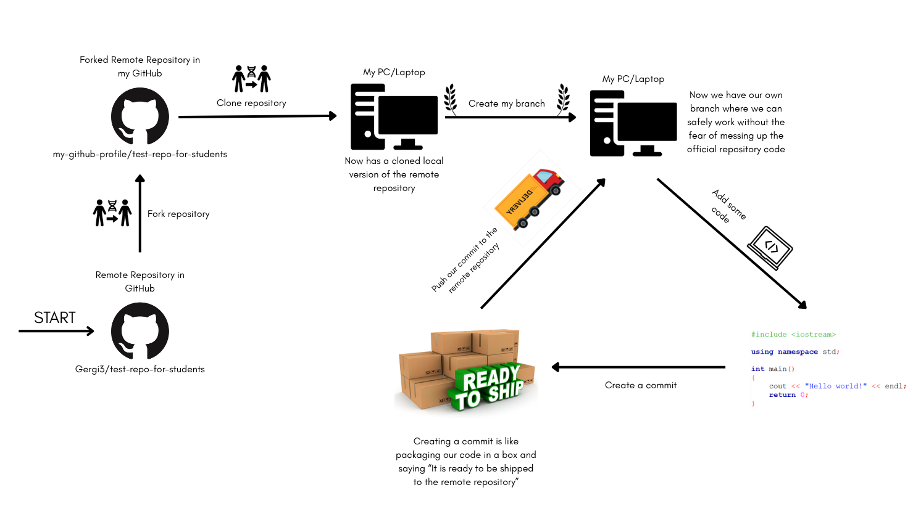
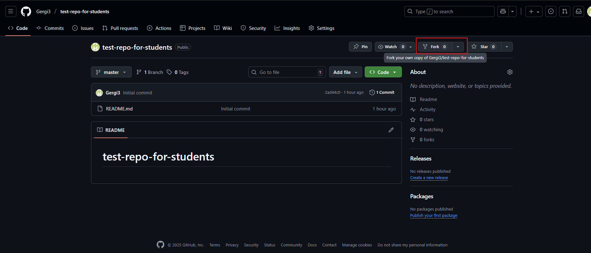
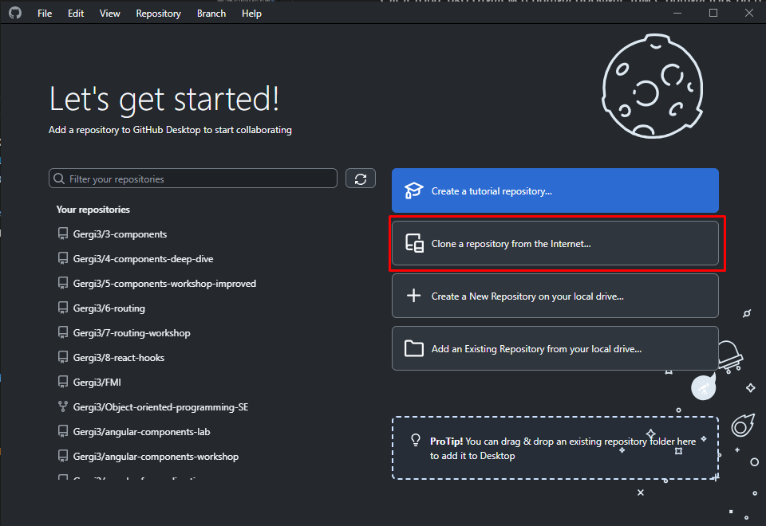
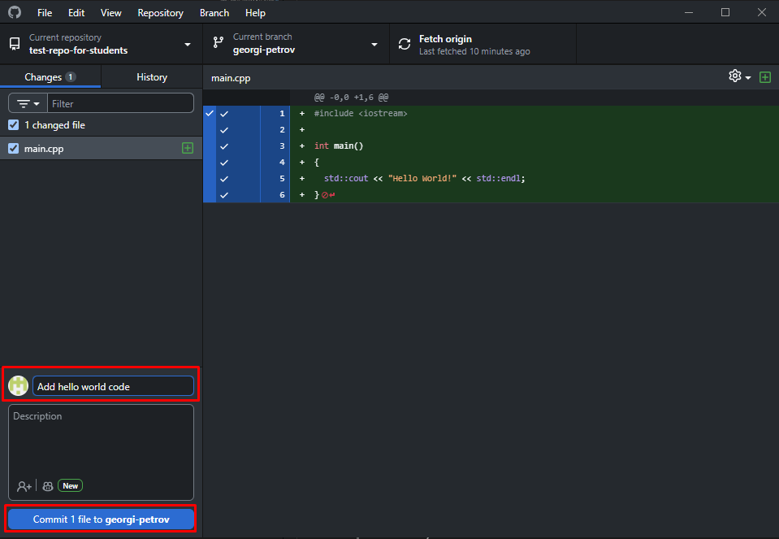
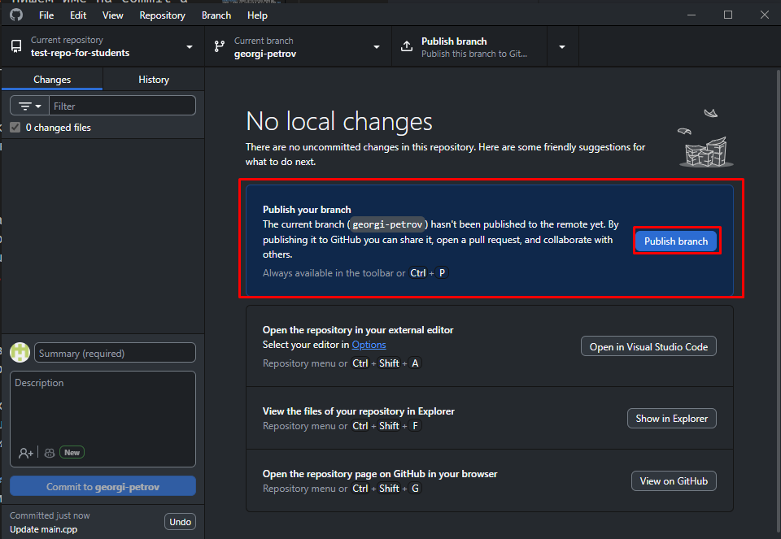
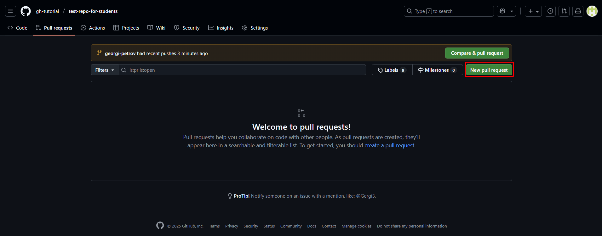
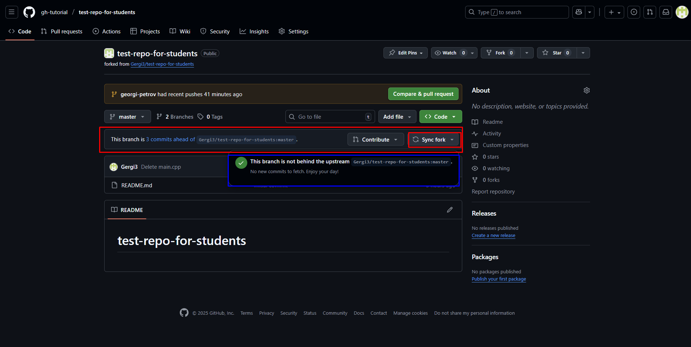

# Семинар 2: Въведение в системи за контрол на версиите (основни функции в GitHub). Условни оператори и оператори за цикъл

## 1. Системи за контрол на версиите

Когато работим по проект (дори сами), искаме да можем:

- да **пазим история на промените** и да виждаме кой, кога и какво е променил;
- да **се връщаме назад** към работеща версия при грешка;
- да **тестваме нови идеи**, без да „чупим“ основния код;
- да **работим в екип**, без да си пречим;
- да имаме **backup** на проекта в облака.

Без VCS обикновено се стига до файлове като `main_v3_final_really_final.cpp`. С VCS имаме един чист `main.cpp`, а цялата история е записана в repository-то.

### Git, GitHub и GitHub Desktop

| Инструмент | Роля |
|------------|------|
| **Git** | Система за контрол на версиите. Работи **локално**, на вашия компютър. |
| **GitHub** | Онлайн платформа, която съхранява Git repository-та в облака и позволява споделяне и съвместна работа (pull requests, issues и др.). |
| **GitHub Desktop** | Графично приложение (GUI), с което ползвате Git и GitHub без команди в терминала. |

> [!TIP]
> Аналогия с фотоалбум: **Git** е фотоапаратът – прави „снимка“ на кода при всяка промяна. **GitHub** е облачният албум (като Google Photos), където снимките се пазят и споделят. **GitHub Desktop** е галерията на компютъра ви – разглеждате, подреждате и синхронизирате снимките без терминал.

> [!NOTE]
> Git и GitHub не са едно и също. Git може да се ползва и без GitHub (само локално), а освен GitHub има и други платформи – GitLab, Bitbucket и др.

### Основни понятия

| Термин | Обяснение |
|--------|-----------|
| **Repository (repo)** | „Папка с памет“ – съдържа файловете на проекта и цялата им история. |
| **Commit** | „Снимка“ (snapshot) на проекта в даден момент, придружена от кратко описание (commit message). |
| **Staging area** | Междинно място, където избираме кои промени да влязат в следващия commit. |
| **Branch** | Паралелна линия на развитие („разклонение“) – работим по нещо ново, без да пипаме основния branch (`main`/`master`). |
| **Merge** | Сливане на промени от един branch в друг. |
| **Remote** | Онлайн копие на repository-то (напр. в GitHub). Обикновено се казва `origin`. |
| **Clone** | Изтегляне на копие на съществуващо remote repo на вашия компютър. |
| **Fork** | Копие на **чуждо** repository във **вашия** GitHub профил. |
| **Push** | Изпращане на локалните commit-и към remote repository-то. |
| **Pull** | Изтегляне на нови промени от remote repository-то към локалното (обратната посока на push). |
| **Pull Request (PR)** | Предложение промените от вашия branch/fork да бъдат слети в друго repository. Около PR-а се води дискусия и се дава обратна връзка. |
| **`.gitignore`** | Текстов файл със списък от файлове/папки, които Git да **не** следи. |

### Типичният цикъл на работа



Основните операции с Git от командния ред (за любопитните – в курса ще ползваме GitHub Desktop):

```bash
git clone https://github.com/<your-username>/<repo>.git   # копираме repo-то локално
git checkout -b ivan-ivanov       # създаваме и минаваме в нов branch
git status                        # какво е променено?
git add main.cpp                  # добавяме файла в staging area
git commit -m "Solve task 1"      # правим commit
git push origin ivan-ivanov       # качваме branch-а в GitHub
git pull                          # изтегляме новите промени
git log --oneline                 # кратка история на commit-ите
```

> [!TIP]
> Пишете ясни commit съобщения, които описват **какво** сте направили: `Solve week 2 tasks 1-5` е много по-полезно от `update` или `asdf`.

### `.gitignore`

При компилация IDE-тата генерират много файлове (`.exe`, `.o`, `Debug/`, `x64/`, `.vs/`, `.idea/`, `cmake-build-debug/` …), които **не трябва** да се качват – те са големи, зависят от компютъра и се генерират наново. Затова в корена на repository-то се добавя файл `.gitignore`:

```gitignore
# Компилирани файлове
*.exe
*.o
*.out

# Папки на IDE-та
.vs/
.vscode/
.idea/
Debug/
Release/
x64/
cmake-build-debug/

# Файлове на операционната система
.DS_Store
Thumbs.db
```

> [!NOTE]
> Готови шаблони за различни езици и IDE-та има в [github/gitignore](https://github.com/github/gitignore) (напр. `C++.gitignore`, `VisualStudio.gitignore`).

---

## 2. Как ще работим с GitHub в курса

Материалите (семинари, задачи, решения) се качват в repository-то на курса в GitHub. Линкът ще получите на семинара.

### Еднократна подготовка

1. **Инсталирайте Git** от [git-scm.com/downloads](https://git-scm.com/downloads). Оставете настройките по подразбиране; уверете се, че е избрано *„Use Git from the command line and also from 3rd-party software“*. При избор на editor изберете нещо познато (напр. VS Code / Notepad++) вместо Vim.
2. **Направете си профил** в [github.com](https://github.com/) (Sign up).
3. **Инсталирайте GitHub Desktop** от [desktop.github.com](https://desktop.github.com/) и влезте с GitHub профила си.
4. **Fork-нете** repository-то на курса (бутон *Fork* горе вдясно). Така получавате копие в своя профил, в което имате права за писане.

   

5. **Clone-нете** своя fork: в GitHub Desktop → *File → Clone repository* → изберете fork-а и *Local path* (папка на компютъра) → *Clone*.

   

6. **Създайте свой branch** (*Current branch → New branch*) с име и фамилия в kebab-case, напр. `ivan-petrov`.

> [!WARNING]
> Стъпки 4–6 се правят **само веднъж**. Не fork-вайте и не clone-вайте наново всяка седмица – работите все в същата локална папка.

### При всяко предаване на решения

1. Добавете/редактирайте файловете си в локалната папка – GitHub Desktop автоматично показва промените.
2. Напишете commit съобщение и натиснете *Commit N files to &lt;branch&gt;*.

   

3. Натиснете *Publish branch* (първия път) / *Push origin* – commit-ите отиват във вашия fork в GitHub.

   

4. В GitHub отворете таба *Pull requests* → *New pull request* и създайте PR от **вашия branch** към оригиналното repository. В заглавието напишете коя седмица/домашно качвате. В този PR ще получавате обратна връзка.

   

### Следене на новите материали (синхронизиране на fork-а)

Новите материали, качени в оригиналното repository, **не** се появяват автоматично във вашия fork. В GitHub, на страницата на вашия fork, натиснете **Sync fork → Update branch**, след което в GitHub Desktop натиснете **Fetch origin / Pull origin**.



> [!WARNING]
> Не редактирайте файловете, качени от нас (`README.md`, `Seminar.md`, решенията). Ако ги промените, при следващо синхронизиране ще се получи **конфликт (merge conflict)** – Git не знае коя версия да запази. Пишете решенията си в **собствени** файлове/папки.

> [!TIP]
> Синхронизирайте fork-а си след всеки семинар/практикум. За упражнение може първо да пробвате целия процес в тестово repository, за да не създавате излишни PR-и в официалното.

---

## 3. Условни оператори

Конструкция, която в зависимост от някакво условие изпълнява (или не) дадена последователност от действия, се нарича **условна** (conditional statement).

### Припомняне: оператори за сравнение и логически оператори

| Оператор | Значение | Пример | Резултат |
|:--------:|----------|:------:|:--------:|
| `<`, `>` | по-малко, по-голямо | `1 < 2` | `true` |
| `<=`, `>=` | по-малко или равно, по-голямо или равно | `2 >= 2` | `true` |
| `==` | равно | `1 == 2` | `false` |
| `!=` | различно | `1 != 2` | `true` |
| `&&` | логическо „И“ (AND) | `true && false` | `false` |
| `\|\|` | логическо „ИЛИ“ (OR) | `true \|\| false` | `true` |
| `!` | логическо „НЕ“ (NOT) | `!true` | `false` |

Приоритет: `!` > аритметични > сравнения (`<`, `>`, …) > `==`, `!=` > `&&` > `||`. При съмнение – слагайте скоби.

> [!NOTE]
> В C++ всяка числова стойност може да се използва като условие: `0` е `false`, **всичко различно от 0** е `true`.

### `if`

```cpp
if (<условие>) {
    <действия>
}
```

Пресмята се стойността на булевия израз `<условие>`. Ако е `true`, се изпълняват `<действия>`; иначе те се пропускат и програмата продължава след блока.

### `if` – `else`

```cpp
#include <iostream>

int main() {
    int n;
    std::cin >> n;

    if (n % 2 == 0) {
        std::cout << n << " is even\n";
    } else {
        std::cout << n << " is odd\n";
    }

    return 0;
}
```

`else` не е задължителен. Изпълнява се, ако условието е `false`.

### `if` – `else if` – `else`

Когато имаме повече от два случая, ги проверяваме последователно. Изпълнява се **първият** клон, чието условие е `true`; останалите се пропускат.

```cpp
#include <iostream>

int main() {
    int percent;
    std::cin >> percent;

    if (percent >= 90) {
        std::cout << "Excellent (6)\n";
    } else if (percent >= 75) {
        std::cout << "Very good (5)\n";   // тук вече знаем, че percent < 90
    } else if (percent >= 60) {
        std::cout << "Good (4)\n";
    } else if (percent >= 40) {
        std::cout << "Fair (3)\n";
    } else {
        std::cout << "Poor (2)\n";
    }

    return 0;
}
```

> [!TIP]
> Във всеки `else if` вече знаем, че **предишните условия са false**. Затова пишем `percent >= 75`, а не `percent >= 75 && percent < 90`.

> [!WARNING]
> Поредица от отделни `if`-ове **не е** същото като `if` – `else if`. При отделните `if`-ове се проверява всяко условие и може да се изпълнят няколко клона. Ако горе заменим `else if` с `if`, при `percent = 95` ще се отпечатат 4 реда.

### Логически оператори в условия

```cpp
#include <iostream>

int main() {
    int a, b, x;
    std::cin >> a >> b >> x;

    if (x >= a && x <= b) {          // математическото a <= x <= b
        std::cout << "Inside [a, b]\n";
    }

    if (x < a || x > b) {
        std::cout << "Outside [a, b]\n";
    }

    if (!(x % 3 == 0)) {             // същото като x % 3 != 0
        std::cout << "Not divisible by 3\n";
    }

    return 0;
}
```

> [!WARNING]
> `a <= x <= b` **не** прави това, което очаквате: първо се смята `a <= x` (0 или 1), а после този резултат се сравнява с `b`. GCC и MSVC го компилират (най-много с предупреждение), а новите версии на Clang дори го отхвърлят като грешка. Винаги пишете `x >= a && x <= b`.

#### Short-circuit оценяване

`&&` и `||` оценяват операндите си **отляво надясно** и спират веднага щом резултатът е ясен:

- при `&&` – ако левият операнд е `false`, десният **не се изчислява**;
- при `||` – ако левият операнд е `true`, десният **не се изчислява**.

```cpp
#include <iostream>

int main() {
    int a = 5, b = 0;

    if (b != 0 && a / b > 1) {   // a / b НЕ се изпълнява, няма деление на 0
        std::cout << "Big ratio\n";
    } else {
        std::cout << "Cannot divide or small ratio\n";
    }

    return 0;
}
```

### Вложени `if`-ове

В тялото на `if` може да има друг `if`.

```cpp
#include <iostream>

int main() {
    char c;
    std::cin >> c;

    if ((c >= 'a' && c <= 'z') || (c >= 'A' && c <= 'Z')) {
        char lower = c;
        if (c >= 'A' && c <= 'Z') {
            lower = c + ('a' - 'A');    // главна -> малка
        }

        if (lower == 'a' || lower == 'e' || lower == 'i' || lower == 'o' || lower == 'u') {
            std::cout << "Vowel\n";
        } else {
            std::cout << "Consonant\n";
        }
    } else {
        std::cout << "Not a Latin letter\n";
    }

    return 0;
}
```

> [!WARNING]
> **„Висящ“ `else` (dangling else):** `else` винаги се свързва с **най-близкия** предходен `if` без `else`, независимо от отстъпа:
>
> ```cpp
> if (x > 0)
>     if (y > 0)
>         std::cout << "both positive";
> else                       // принадлежи на if (y > 0), а не на if (x > 0)!
>     std::cout << "x is not positive";
> ```
>
> Слагайте винаги фигурни скоби `{ }`, дори когато тялото е един ред.

### Чести грешки

> [!WARNING]
> - **`=` вместо `==`:** `if (x = 5)` присвоява 5 на `x` и условието винаги е `true`. Компилирайте с `-Wall`, за да получите предупреждение.
> - **`;` след условието:** `if (x > 0);` – точката и запетаята е празно тяло, а блокът след нея се изпълнява **винаги**.
> - **Сравнение на `double` с `==`:** `0.1 + 0.2 == 0.3` е `false` заради грешки при закръгляне. Сравнявайте с точност: `std::fabs(a - b) < 1e-9` (от `<cmath>`).

> [!NOTE]
> **Ще разгледаме в Семинар 3:** операторът `switch` (за избор по конкретни стойности, напр. ден от седмицата) и тернарният оператор `условие ? a : b` (напр. `int max = (a > b) ? a : b;`). Засега всичко може да се реши с `if` – `else if`.

---

## 4. Въведение в циклите

**Цикъл** (loop) е конструкция, която изпълнява многократно дадена последователност от действия. Различаваме:

- **индуктивен** цикличен процес – броят повторения е **известен** предварително (напр. „отпечатай числата от 1 до n“);
- **итеративен** цикличен процес – броят повторения **не е известен** предварително (напр. „чети числа, докато не въведат 0“).

### `while`

```cpp
while (<условие>) {
    <тяло>
}
```

1. Пресмята се `<условие>`.
2. Ако е `false` – цикълът приключва (тялото може да не се изпълни нито веднъж).
3. Ако е `true` – изпълнява се тялото и се връщаме на стъпка 1.

```cpp
#include <iostream>

int main() {
    // Сумираме числа, докато не въведат 0
    int sum = 0;
    int x;
    std::cin >> x;

    while (x != 0) {
        sum += x;
        std::cin >> x;
    }

    std::cout << "Sum: " << sum << '\n';
    return 0;
}
```

```cpp
#include <iostream>

int main() {
    // Брой цифри на неотрицателно число
    int n;
    std::cin >> n;

    int digits = 0;
    do {                     // ще го разгледаме подробно в Семинар 3
        ++digits;
        n /= 10;
    } while (n != 0);

    std::cout << digits << '\n';
    return 0;
}
```

> [!WARNING]
> Ако в тялото на `while` нищо не променя условието, получаваме **безкраен цикъл**:
>
> ```cpp
> int i = 0;
> while (i < 10) {
>     std::cout << i;   // забравили сме ++i
> }
> ```

### `for`

Използва се най-често, когато броят на повторенията е известен.

```cpp
for (<инициализация>; <условие>; <корекция>) {
    <тяло>
}
```

1. `<инициализация>` се изпълнява **веднъж** в началото.
2. Проверява се `<условие>`; ако е `false` – край.
3. Изпълнява се тялото.
4. Изпълнява се `<корекция>` и се връщаме на стъпка 2.

```cpp
#include <iostream>

int main() {
    int n;
    std::cin >> n;

    // Числата от 1 до n
    for (int i = 1; i <= n; ++i) {
        std::cout << i << ' ';
    }
    std::cout << '\n';

    // Сума на четните числа в [2, n]
    int sum = 0;
    for (int i = 2; i <= n; i += 2) {
        sum += i;
    }
    std::cout << "Sum of evens: " << sum << '\n';

    // n!
    long long factorial = 1;
    for (int i = 2; i <= n; ++i) {
        factorial *= i;
    }
    std::cout << n << "! = " << factorial << '\n';

    return 0;
}
```

> [!NOTE]
> Всеки `for` може да се запише като `while` и обратно:
>
> ```cpp
> int i = 1;              // инициализация
> while (i <= n) {        // условие
>     std::cout << i << ' ';
>     ++i;                // корекция
> }
> ```
>
> Променлива, декларирана в заглавието на `for` (като `int i`), съществува само в рамките на цикъла.

### Цикъл + условие

Най-често в тялото на цикъла има `if`:

```cpp
#include <iostream>

int main() {
    // Прочитаме n числа и намираме най-голямото
    int n;
    std::cin >> n;

    int max;
    std::cin >> max;               // първото число е начален кандидат
    for (int i = 1; i < n; ++i) {
        int x;
        std::cin >> x;
        if (x > max) {
            max = x;
        }
    }

    std::cout << "Max: " << max << '\n';
    return 0;
}
```

> [!TIP]
> Инициализирайте максимума с **първото прочетено число**, а не с `0` – иначе програмата греши, ако всички числа са отрицателни.

> [!NOTE]
> **В Семинар 3:** `do-while` в детайли, вложени цикли, операторите `break` (прекъсва цикъла) и `continue` (прескача към следващата итерация), както и по-сложни задачи с цифри на число, прости числа, НОД и др.

---

## Какво ще отпечата?

**1.** Каква е разликата между `clone` и `fork`? А между `commit` и `push`?

<details><summary>Отговор</summary>

**Fork** е копие на чуждо repository в **вашия GitHub профил** (в облака). **Clone** изтегля repository (напр. вашия fork) на **компютъра ви**.
**Commit** записва снимка на промените **локално**; **push** изпраща вече направените commit-и към remote repository-то в GitHub. Без push промените не се виждат онлайн.

</details>

**2.** Какво ще отпечата?

```cpp
int x = 15;
if (x > 10) {
    std::cout << "A";
}
if (x > 5) {
    std::cout << "B";
} else if (x > 0) {
    std::cout << "C";
} else {
    std::cout << "D";
}
```

<details><summary>Отговор</summary>

`AB` – първият `if` е самостоятелен и се изпълнява; във веригата `if – else if – else` се изпълнява само първият истинен клон (`x > 5`).

</details>

**3.** Какво ще отпечата?

```cpp
int x = 0;
if (x = 0) {
    std::cout << "zero";
} else {
    std::cout << "not zero";
}
```

<details><summary>Отговор</summary>

`not zero`. `x = 0` е **присвояване**, а стойността на израза е 0, т.е. `false`. Правилно е `x == 0`.

</details>

**4.** Какво ще отпечата?

```cpp
int a = 5, b = 10, c = 3;
std::cout << (a < b && b < c) << ' ' << (a < b || b < c) << ' ' << !(a == 5);
```

<details><summary>Отговор</summary>

`0 1 0`

</details>

**5.** Какво ще отпечата?

```cpp
int x = 7;
if (2 <= x <= 5) {
    std::cout << "in range";
} else {
    std::cout << "out of range";
}
```

<details><summary>Отговор</summary>

`in range`! `2 <= x` е `true` (1), а `1 <= 5` също е `true`. (Новите версии на Clang изобщо отказват да компилират такъв израз.) Правилният запис е `x >= 2 && x <= 5`.

</details>

**6.** Какво ще отпечата?

```cpp
int x = -3;
if (x > 0);
{
    std::cout << "positive";
}
```

<details><summary>Отговор</summary>

`positive`. Точката и запетаята след `if (x > 0)` е празно тяло на `if`-а, а блокът `{ ... }` е отделен и се изпълнява винаги.

</details>

**7.** Какво ще отпечата?

```cpp
int i = 10;
while (i < 5) {
    std::cout << i << ' ';
    ++i;
}
std::cout << "end";
```

<details><summary>Отговор</summary>

`end` – условието е `false` още в началото, тялото не се изпълнява нито веднъж.

</details>

**8.** Какво ще отпечата?

```cpp
int sum = 0;
for (int i = 1; i <= 10; i += 3) {
    sum += i;
}
std::cout << sum;
```

<details><summary>Отговор</summary>

`22` (1 + 4 + 7 + 10).

</details>

**9.** Какво ще отпечата?

```cpp
int n = 1234, s = 0;
while (n > 0) {
    s += n % 10;
    n /= 10;
}
std::cout << s;
```

<details><summary>Отговор</summary>

`10` – сумата на цифрите на 1234.

</details>

---

## Ресурси

**Git и GitHub**
- [Pro Git – официалната книга](https://git-scm.com/book/en/v2)
- [GitHub Docs – Get started](https://docs.github.com/en/get-started)
- [GitHub Desktop документация](https://docs.github.com/en/desktop)
- [Learn Git Branching (интерактивно)](https://learngitbranching.js.org/)
- [Git Cheat Sheet (GitHub Education)](https://education.github.com/git-cheat-sheet-education.pdf)
- [Шаблони за `.gitignore`](https://github.com/github/gitignore)
- [Git и GitHub видео курс (Traversy Media)](https://www.youtube.com/watch?v=RGOj5yH7evk)

**Условни оператори и цикли**
- [learncpp: Introduction to if statements](https://www.learncpp.com/cpp-tutorial/introduction-to-if-statements/)
- [learncpp: Logical operators](https://www.learncpp.com/cpp-tutorial/logical-operators/)
- [learncpp: Common if statement problems](https://www.learncpp.com/cpp-tutorial/common-if-statement-problems/)
- [learncpp: Introduction to loops and while statements](https://www.learncpp.com/cpp-tutorial/introduction-to-loops-and-while-statements/)
- [learncpp: For statements](https://www.learncpp.com/cpp-tutorial/for-statements/)
- [cppreference: if statement](https://en.cppreference.com/w/cpp/language/if)
- [cppreference: while loop](https://en.cppreference.com/w/cpp/language/while), [for loop](https://en.cppreference.com/w/cpp/language/for)
