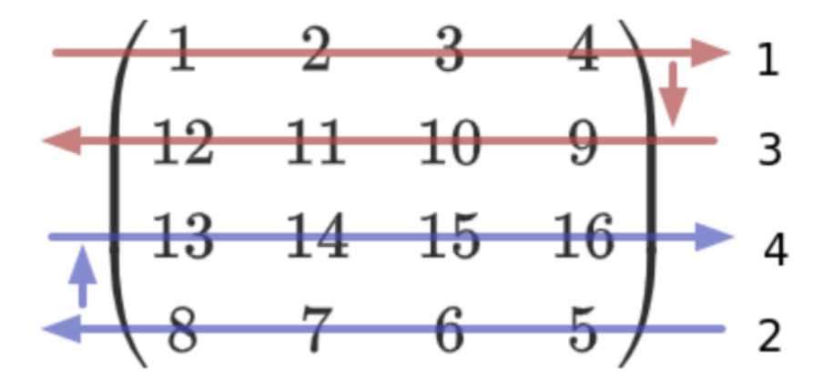

# Задачи – Семинар 7: Многомерни масиви. Обхождане, търсене, диагонали, спирала. Ефективност

Освен ако не е казано друго: матриците са с размери до `100 x 100`, въвеждат се от стандартния вход – първо броят редове и колони (или само `n` за квадратна матрица), след това елементите ред по ред. Решавайте с **функции**, които приемат матрицата като `int m[][MAX_SIZE]` (`const`, ако само я четат). Не използвайте `std::vector` и `std::string`.

За всяка задача се опитайте да определите **сложността** на решението си (*O(n)*, *O(n²)*, *O(n · m)*...).

Решения на част от задачите има в папка [`solutions/`](./solutions) (`taskK.cpp`). Първо опитайте сами! Някои от решенията (9–13) работят с матрици, зададени директно в кода, а 6 чете `rows cols` вместо само `n` – форматът на входа може леко да се различава от условието.

---

## Загрявка

### Задача 1: Най-малък елемент

Напишете функции за въвеждане и отпечатване на матрица `rows x cols`, както и функция, която връща най-малкия елемент на матрицата.

```text
Вход:
3 3
3 5 1
6 2 4
9 0 8

Изход:
0
```

<details><summary>Подсказка</summary>

Започнете минимума от `m[0][0]`, а не от `0` – иначе за матрица само от положителни числа ще получите грешен отговор.

</details>

### Задача 2: Диагонали

Напишете функция, която приема квадратна матрица `n x n` и отпечатва главния ѝ диагонал, а след това – второстепенния.

```text
Вход:
3
1 2 3
4 5 6
7 8 9

Изход:
1 5 9
3 5 7
```

<details><summary>Подсказка</summary>

Един цикъл е достатъчен: главният диагонал е `m[i][i]`, второстепенният – `m[i][n - 1 - i]`. Не са нужни два вложени цикъла с `if (i == j)`.

</details>

### Задача 3: Суми по редове и колони

Напишете функции `rowSum` и `colSum`, които връщат сумата на даден ред/колона. Отпечатайте сумите на всички редове, на всички колони и индекса на реда с най-голяма сума (при равенство – първия).

```text
Вход:
3 4
1 2 3 4
5 6 7 8
9 10 11 12

Изход:
Rows: 10 26 42
Cols: 15 18 21 24
Max row: 2
```

### Задача 4: Зиг-заг

Напишете функция, която отпечатва елементите на матрица на зиг-заг: първият ред отляво надясно, вторият – отдясно наляво, третият – отляво надясно и т.н.

```text
Вход:
3 3
1 2 3
4 5 6
7 8 9

Изход:
1 2 3
6 5 4
7 8 9
```

<details><summary>Подсказка</summary>

Внимавайте с обратния цикъл: `for (size_t j = cols - 1; j >= 0; j--)` никога не спира. Използвайте `int`.

</details>

### Задача 5: Триъгълна матрица

Напишете функция, която приема квадратна матрица `n x n` и връща дали тя е **горна триъгълна**, т.е. под главния диагонал има само нули.

| Вход | Изход |
| ---- | ----- |
| `3`<br>`5 1 5`<br>`0 5 9`<br>`0 6 7` | `0` |
| `3`<br>`5 1 5`<br>`0 5 9`<br>`0 0 7` | `1` |

<details><summary>Подсказка</summary>

Под главния диагонал са елементите с `i > j`. Обходете само тях (`j` от `0` до `i - 1`) и прекратете при първия ненулев.

</details>

---

## Основни задачи

### Задача 6: Транспониране на квадратна матрица

Напишете функция, която транспонира квадратна матрица `n x n` **на място** (без помощна матрица).

```text
Вход:
3
1 2 3
4 5 6
7 8 9

Изход:
1 4 7
2 5 8
3 6 9
```

<details><summary>Подсказка</summary>

Разменяйте `m[i][j]` и `m[j][i]` само за `j > i`. Ако обходите всички двойки, всяка ще се размени два пъти и матрицата ще остане същата.

</details>

### Задача 7: Транспониране на правоъгълна матрица

Напишете функция `transpose(const int m[][MAX_SIZE], int rows, int cols, int result[][MAX_SIZE])`, която записва транспонираната на `m` матрица в `result`. Отпечатайте я.

```text
Вход:
2 3
1 2 3
4 5 6

Изход:
1 4
2 5
3 6
```

### Задача 8: Области спрямо диагоналите

Напишете четири функции, които за квадратна матрица `n x n` връщат сумата на елементите:

- над главния диагонал;
- под главния диагонал;
- над второстепенния диагонал;
- под второстепенния диагонал.

Елементите **върху** диагонала не се включват. Не използвайте `if` в циклите – нека границите на циклите описват областта.

```text
Вход:
4
1 2 3 4
5 6 7 8
9 10 11 12
13 14 15 16

Изход:
Above main: 36
Below main: 66
Above secondary: 26
Below secondary: 76
```

<details><summary>Подсказка</summary>

Условията са `i < j`, `i > j`, `i + j < n - 1`, `i + j > n - 1`. Например за „под второстепенния“ при ред `i` колоните са от `n - i` до `n - 1`.

</details>

### Задача 9: Събиране на матрици

Напишете функция, която събира две матрици с еднакви размери и записва резултата в трета. Ако размерите не съвпадат, функцията да връща `false`.

```text
Вход:
2 3
1 2 3
4 5 6
2 3
5 6 7
8 9 10

Изход:
6 8 10
12 14 16
```

### Задача 10: Умножение с число

Напишете функция, която умножава всеки елемент на матрица с дадено число.

```text
Вход:
2 3
1 2 3
4 5 6
3

Изход:
3 6 9
12 15 18
```

### Задача 11: Умножение на матрици

Напишете функция, която умножава матрица `A` с размери `n x k` по матрица `B` с размери `k x m` и записва резултата `C` (`n x m`) в трета матрица, където `C[i][j] = A[i][0]·B[0][j] + A[i][1]·B[1][j] + ... + A[i][k-1]·B[k-1][j]`. Ако броят колони на `A` не е равен на броя редове на `B`, функцията да връща `false`.

```text
Вход:
5 2
1 2
8 9
10 0
1 0
2 2
2 3
1 2 3
4 5 2

Изход:
9 12 7
44 61 42
10 20 30
1 2 3
10 14 10
```

<details><summary>Подсказка</summary>

Три вложени цикъла: по `i`, по `j` и по `p` за сумата. Не забравяйте да нулирате `C[i][j]` преди да натрупвате. Каква е сложността за квадратни `n x n` матрици?

</details>

### Задача 12: Магически квадрат

Квадратна матрица е **магически квадрат**, ако сумите на всеки ред, всяка колона и двата диагонала са равни. Напишете функция, която проверява дали дадена матрица е магически квадрат.

| Вход | Изход |
| ---- | ----- |
| `3`<br>`1 2 3`<br>`4 5 6`<br>`7 8 9` | `0` |
| `3`<br>`13 8 15`<br>`14 12 10`<br>`9 16 11` | `1` (сума 36) |
| `4`<br>`16 3 2 13`<br>`5 10 11 8`<br>`9 6 7 12`<br>`4 15 14 1` | `1` (сума 34) |

<details><summary>Подсказка</summary>

Използвайте функциите `rowSum`/`colSum` от задача 3 и функции за сумите на диагоналите. Сравнявайте всичко със сумата на първия ред.

</details>

### Задача 13: Завъртане на 90°

Напишете функция, която завърта квадратна матрица на 90° по часовниковата стрелка (на място).

```text
Вход:
3
1 2 3
4 5 6
7 8 9

Изход:
7 4 1
8 5 2
9 6 3
```

<details><summary>Подсказка</summary>

Завъртането = транспониране + обръщане на всеки ред. Как бихте завъртели обратно на часовниковата стрелка?

</details>

### Задача 14: Спирала

Напишете функция, която отпечатва елементите на матрица `rows x cols` спираловидно – отвън навътре, по часовниковата стрелка, започвайки от горния ляв ъгъл.

| Вход | Изход |
| ---- | ----- |
| `3 3`<br>`1 2 3`<br>`4 5 6`<br>`7 8 9` | `1 2 3 6 9 8 7 4 5` |
| `4 3`<br>`1 2 3`<br>`4 5 6`<br>`7 8 9`<br>`10 11 12` | `1 2 3 6 9 12 11 10 7 4 5 8` |
| `1 4`<br>`1 2 3 4` | `1 2 3 4` |

<details><summary>Подсказка</summary>

Пазете четири граници `top`, `bottom`, `left`, `right` и ги свивайте след всяка обходена страна. Тествайте с `1 x n` и `n x 1` – там най-често се печатат елементи по два пъти.

</details>

### Задача 15: Диагонално обхождане

Напишете функция, която отпечатва елементите на матрица `rows x cols` по диагоналите, успоредни на второстепенния: всеки диагонал на отделен ред, като всеки се обхожда отдолу-наляво нагоре-надясно.

```text
Вход:
5 4
1 2 3 4
5 6 7 8
9 10 11 12
13 14 15 16
17 18 19 20

Изход:
1
5 2
9 6 3
13 10 7 4
17 14 11 8
18 15 12
19 16
20
```

<details><summary>Подсказка</summary>

Всички елементи на един такъв диагонал имат една и съща сума `i + j = d`, като `d` е от `0` до `rows + cols - 2`.

</details>

### Задача 16: Търсене в матрица

Напишете функция, която по дадена матрица и число `x` отпечатва координатите на всички срещания на `x` и връща броя им. Ако `x` не се среща – отпечатайте `Not found`.

```text
Вход:
3 3
1 2 1
4 1 6
7 8 1
1

Изход:
(0, 0)
(0, 2)
(1, 1)
(2, 2)
Count: 4
```

### Задача 17: Търсене в сортирана матрица

Дадена е матрица, в която **всеки ред и всяка колона са сортирани нарастващо**. Напишете функция, която проверява дали число `x` се среща в нея и връща координатите му, със сложност *O(rows + cols)* (не *O(rows · cols)*!).

| Вход | Изход |
| ---- | ----- |
| `4 4`<br>`1 4 7 11`<br>`2 5 8 12`<br>`3 6 9 16`<br>`10 13 14 17`<br>`6` | `Found at (2, 1)` |
| същата матрица, `15` | `Not found` |

<details><summary>Подсказка</summary>

Започнете от горния десен ъгъл. Ако текущият елемент е по-голям от `x`, всички под него в колоната също са по-големи – махнете колоната. Ако е по-малък – всички вляво в реда са по-малки – махнете реда.

</details>

### Задача 18: Дубликати – бавно и бързо

Даден е масив от `n` цели числа (`1 <= n <= 100 000`) със стойности в интервала `[0, 1000]`. Да се намери броят на двойките индекси `i < j`, за които `arr[i] == arr[j]`. Напишете **две** функции:

- **А:** с два вложени цикъла – *O(n²)*;
- **Б:** с помощен масив за броене на срещанията – *O(n + 1000)*.

```text
Вход:
7
3 5 8 2 5 0 5

Изход:
3
3
```

<details><summary>Подсказка</summary>

Стойност, която се среща `k` пъти, образува `k(k - 1) / 2` двойки. Генерирайте вход с `n = 100 000` и сравнете колко време отнемат двете функции. Внимавайте – отговорът може да не се събира в `int`.

</details>

---

## По-трудни задачи

### Задача 19: Попълване на спирала

По дадени `rows` и `cols` попълнете матрица с числата от `1` до `rows · cols` по спирала (по часовниковата стрелка, от горния ляв ъгъл) и я отпечатайте.

```text
Вход:
4 4

Изход:
1  2  3  4
12 13 14 5
11 16 15 6
10 9  8  7
```

```text
Вход:
3 4

Изход:
1  2  3  4
10 11 12 5
9  8  7  6
```

### Задача 20: Морски шах (Tic-Tac-Toe)

Реализирайте в **конзолата** играта морски шах за двама играчи върху дъска `3 x 3` (`char board[3][3]`). Играта започва с празна дъска и на всяка стъпка:

- текущият играч (`X` или `O`) **въвежда две числа – ред и колона** (напр. `1 3`);
- ако клетката е заета или извън дъската – въвежда отново;
- след всеки ход се отпечатва дъската и се проверява дали има победител (три еднакви на ред, колона или някой от двата диагонала) или реми.

```text
 X | O |
---+---+---
   | X |
---+---+---
   |   | O
Player X, enter row and column: 3 1
```

Онлайн версия на играта: [playtictactoe.org](https://playtictactoe.org)

<details><summary>Подсказка</summary>

Отделете логиката във функции: `printBoard`, `isValidMove`, `hasWinner(board, symbol)`, `isFull`. Проверката за победител използва точно обхожданията от семинара – ред, колона, главен и второстепенен диагонал.

</details>

**Бонус:** рефакторирайте играта така, че дъската да е `n x n` (`3 <= n <= 50`), а играчите – `x` на брой (`2 <= x <= 50`). Колко еднакви символа подред трябва за победа – решете сами (напр. `n`).

### Задача 21: Склад (тримерен масив)

Склад има `F` етажа, всеки с `R` реда и `C` колони рафтове (`1 <= F, R, C <= 10`). За всеки рафт е даден броят кашони върху него – `warehouse[f][r][c]`. Напишете програма, която прочита данните етаж по етаж и отпечатва:

- общия брой кашони;
- етажа с най-много кашони (и колко са);
- координатите на рафта с най-много кашони.

Използвайте функция, която пресмята сумата на един етаж, като ѝ подавате `warehouse[f]` – двумерен масив.

```text
Вход:
2 2 3
1 2 3
4 5 6
0 9 1
1 1 1

Изход:
Total: 34
Busiest floor: 0 (21)
Max cell: (1, 0, 1) = 9
```

### Задача 22: Експеримент – редове срещу колони

Декларирайте **глобална** матрица `int matrix[N][N]` с `N = 4000` и я попълнете. Напишете две функции, които връщат сумата на всички елементи:

- обхождане по редове – `matrix[i][j]`, вътрешен цикъл по `j`;
- обхождане по колони – `matrix[i][j]`, вътрешен цикъл по `i`.

Измерете времето им (може с `<chrono>`, вижте примера от семинара). Повторете за `N = 500, 1000, 2000, 4000`. Отговорете:

1. Каква е сложността на двете функции?
2. Коя е по-бърза и защо? Как се отнася това към начина, по който матрицата стои в паметта?
3. Защо матрицата трябва да е глобална, а не локална в `main`?

---

## Задачи от контролни и изпити

### Задача 23: Седлова точка

*(Контролно 2, 2024/25 г.)*

От стандартния вход се прочитат елементите на матрица `6 x 6` (сред които поне едно число е различно от останалите). **Седлова точка** на матрица е елемент, който е **най-голям в реда си** и **най-малък в колоната си**. Напишете функция, която по подадена матрица и нейните размери отпечатва координатите на седловата точка (ако са няколко – първата по редове). Ако матрицата няма седлова точка, да се изведе подходящо съобщение.

```text
Вход:
10 11 12 13 14 15
11 12 13 14 15 16
0 1 2 3 4 5
13 14 15 16 17 18
14 15 16 17 18 19
15 16 17 18 19 20

Изход:
2 5
```

```text
Вход:
0 1 2 3 4 5
1 2 3 4 5 0
2 3 4 5 0 1
3 4 5 0 1 2
4 5 0 1 2 3
5 0 1 2 3 4

Изход:
No saddle point
```

### Задача 24: Обхождане по схема

*(Контролно 2, 2024/25 г.)*

Дадена е матрица с размер `4 x 4` от цели числа. Да се напише програма, която извежда елементите на матрицата в реда, показан на схемата:



```text
Вход:
1 2 3 4
12 11 10 9
13 14 15 16
8 7 6 5

Изход:
1 2 3 4 5 6 7 8 9 10 11 12 13 14 15 16
```

**За упражнение:** обобщете за матрица `n x n` (тогава първо се въвежда `n`).

<details><summary>Подсказка</summary>

Редовете се обхождат в ред `0, n-1, 1, n-2, ...`. Посоката зависи от **номера на реда**: четните редове – отляво надясно, нечетните – отдясно наляво.

</details>

### Задача 25: Система линейни уравнения (метод на Гаус)

Напишете функция, която приема матрица `n x (n + 1)` (`double`) – разширената матрица на система от `n` линейни уравнения с `n` неизвестни – и решава системата чрез **метода на Гаус** (с елементарни преобразувания по редове, свеждаме до триъгълен вид и после намираме неизвестните отзад напред).

Програмата трябва да разпознава, когато системата **няма решение** или има **безброй много решения**, и да отпечатва подходящо съобщение.

Например системата

```text
-3x + 2y - 5z = 0
 2x - 3y + 4z = 10
 2x +  y +  z = 4
```

```text
Вход:
3
-3 2 -5 0
2 -3 4 10
2 1 1 4

Изход:
x = 14, y = -11.14, z = -12.86
```

(точното решение е *x = 14*, *y = -78/7*, *z = -90/7*)

<details><summary>Подсказка</summary>

За всяка колона `c` намерете ред `r >= c` с ненулев елемент в колона `c` и го разменете с ред `c`; после извадете подходящо кратно на ред `c` от всички редове под него. Ако такъв ред няма – детерминантата е 0 (няма или има безброй решения). Сравнявайте `double` с нула чрез `fabs(x) < 1e-9`, а не с `== 0`.

</details>
